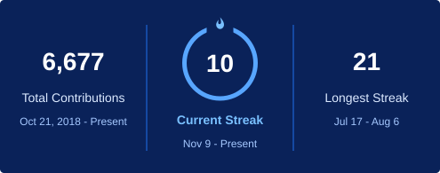
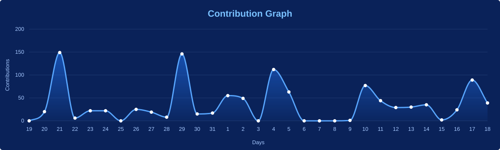

<p align="center">
  
</p>

<p align="center">
  
</p>

<p align="center">
  
  <a href="https://github.com/Fudzuki?tab=followers"></a>
  
</p>

---

### 🐾 About me

```ts
const kusanagi = {
  handle: "@Fudzuki",
  location: "Japan 🇯🇵",
  work: ["Wideplink", "Discope", "TAO"],
  favoriteColor: "blue",
  companion: "a white cat 🐈",
};
```

### 🛠 Tech stack

<p align="center">
  
</p>

### 📊 GitHub stats

<p align="center">
  
  
</p>

<p align="center">
  
</p>

<p align="center">
  
</p>

<p align="center">
  
</p>
